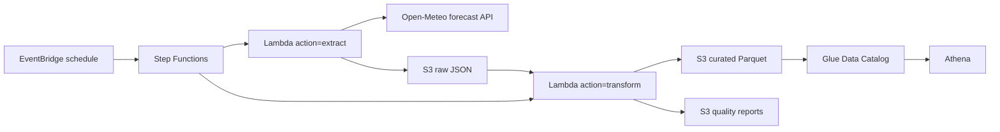

# Open-Meteo weather ETL

Personal portfolio project for a data engineering profile. It ingests the public [Open-Meteo](https://open-meteo.com/) forecast API (no API key), lands the raw JSON, checks the batch, and writes a curated Parquet dataset that Athena can query.

This repository does not deploy anything. Nothing here is running in production, and there are no users or production metrics. The AWS design is the shape I would use for a small scheduled lake pipeline. The path below, `make test` and `make run-local`, needs no AWS account and costs nothing.

[](https://github.com/HAraujo14/aws-etl-pipeline-terraform/actions/workflows/ci.yml)

## What it does

Once a day, for a short list of cities:

1. **Extract.** Call the Open-Meteo forecast API and store the response body unchanged as JSON.
2. **Transform.** Flatten the hourly arrays into one row per location and hour, with explicit units and types, and write Snappy Parquet.
3. **Quality gate.** Check schema, nulls, ranges, duplicates, freshness, and a few source-specific rules. A failed batch does not publish Parquet.
4. **Query.** A Glue table with partition projection points Athena at the curated prefix. No crawler.

The same Python package runs on your laptop and inside Lambda. Local mode writes a directory tree. AWS mode writes S3.

## Architecture



Extract and transform are two invocations of one function, so a transform failure can be retried without fetching the API again. The raw object is the checkpoint. Local mode calls the same two stages in one process and skips Glue.

The function is not in a VPC. It has to reach the public API, and a VPC would need a NAT gateway, which is not a free-tier resource.

## Repository layout

```text
src/weather_etl/          pipeline package (CLI, Lambda handler, checks)
tests/                    pytest, including moto S3 tests; no network
infra/                    Terraform root module
infra/modules/            s3_datalake, ecr, iam, lambda_pipeline,
                          orchestration, glue_athena
sql/athena/               example queries
.github/workflows/ci.yml  ruff, black, pytest, terraform fmt, terraform validate
```

## Data model

`ingest_date` is the UTC date the pipeline ran, not the weather event date. It is a partition key only. It is not a column inside the Parquet file, so Athena will not see it twice.

Raw objects, one per city:

```text
s3://<bucket>/raw/weather/ingest_date=YYYY-MM-DD/location_id=<id>/forecast.json
```

Curated object, one file per run:

```text
s3://<bucket>/curated/weather/ingest_date=YYYY-MM-DD/observations.parquet
```

Quality report, written on success and on failure:

```text
s3://<bucket>/quality/weather/ingest_date=YYYY-MM-DD/quality_report.json
```

The report lives outside the curated prefix so a Glue/Athena scan never tries to read JSON.

| Column | Type | Meaning |
| --- | --- | --- |
| `observation_time` | timestamp (UTC) | Forecast hour |
| `location_id` | string | `berlin`, `sao_paulo`, `new_york` by default |
| `latitude`, `longitude` | double | Coordinates returned by the API |
| `elevation_m` | double | Elevation in meters |
| `temperature_c` | double | Temperature at 2 m, °C |
| `relative_humidity_pct` | double | Relative humidity at 2 m, % |
| `precipitation_mm` | double | Precipitation in the hour, mm |
| `wind_speed_kmh` | double | Wind speed at 10 m, km/h |
| `data_source` | string | Constant `open-meteo` |
| `ingested_at` | timestamp (UTC) | When the transform built the frame |
| `ingest_date` | date partition | UTC day of the pipeline run |

The API request sets `temperature_unit=celsius`, `wind_speed_unit=kmh`, `precipitation_unit=mm`, and `timezone=UTC`. The transform rejects a payload whose `hourly_units` do not match that contract.

Default locations are Berlin, São Paulo, and New York, with `forecast_days=1` (24 hourly rows per city). Override them with `LOCATIONS_JSON` or the Terraform `locations` variable. A location id must match `^[a-z][a-z0-9_]{0,62}$` so it is safe to put in an object key.

## Data quality rules

The transform builds the frame, writes the quality report, and only then writes Parquet. A failure raises, which makes the Lambda invocation fail and the Step Functions execution fail. The raw JSON and the report stay where they are. There is no curated file for that date.

| Check | Rule |
| --- | --- |
| `schema` | The curated columns are present, there are no extras, timestamps are timezone-aware, ids are strings, and measures are floats. Later checks are skipped when this fails. |
| `row_count` | At least one row. |
| `not_null` | No nulls in `observation_time`, `location_id`, `latitude`, `longitude`, `data_source`, or `ingested_at`. |
| `null_ratio` | Null ratio of each measure (`temperature_c`, humidity, precipitation, wind, elevation) is at most 5%. |
| `ranges` | Temperature −80 to 60 °C, humidity 0 to 100, precipitation 0 to 500 mm, wind 0 to 400 km/h, latitude −90 to 90, longitude −180 to 180, elevation −500 to 9000 m. Bounds are inclusive. Nulls are ignored here and counted above. |
| `duplicates` | Unique `(location_id, observation_time)`. |
| `freshness` | Observations cover `ingest_date` and stay inside `[ingest_date, ingest_date + forecast_days]`. A batch of old hours filed under today fails. |
| `locations` | The configured cities are present, and no extra city appears. |
| `coordinates` | Each city's coordinates are within 1 degree of the configured point. Open-Meteo snaps to its own grid, so an exact match would be wrong. |
| `data_source` | Every row is `open-meteo`. |

Unit mismatches and ragged hourly arrays fail in the transform, before these checks, because they mean the payload is not the dataset this schema describes.

## Run locally

Requires Python 3.12. No AWS credentials, no Docker, no API key.

```bash
python3 -m venv .venv
source .venv/bin/activate
pip install -r requirements.txt -r requirements-dev.txt
export PYTHONPATH=src

make test
make run-local
```

`make test` uses a saved API payload and moto. It does not call Open-Meteo.

`make run-local` does call the public API once per default city (three small requests) and writes:

```text
data/raw/weather/ingest_date=YYYY-MM-DD/location_id=<id>/forecast.json
data/curated/weather/ingest_date=YYYY-MM-DD/observations.parquet
data/quality/weather/ingest_date=YYYY-MM-DD/quality_report.json
```

Other commands:

```bash
python -m weather_etl extract --date 2026-10-22 --backend local
python -m weather_etl transform --date 2026-10-22 --backend local
python -m weather_etl run --backend local
```

Copy `.env.example` if you want a single city or a different output directory. `STORAGE_BACKEND=local` is the default.

Pre-commit runs Ruff and Black:

```bash
pip install pre-commit
pre-commit install
```

Docker is only needed when you want the Lambda image. It is not required for the local pipeline:

```bash
docker build -t weather-etl .
docker run --rm --entrypoint python \
  -v "$PWD/data:/var/task/data" \
  -e STORAGE_BACKEND=local \
  -e LOCAL_DATA_DIR=/var/task/data \
  weather-etl -m weather_etl run
```

## Deploy to AWS

You need Terraform >= 1.6, Docker, and AWS credentials that can create the resources below. This repo does not contain credentials, and CI never runs `terraform apply`.

The first apply creates the bucket, ECR repository, IAM roles, Glue table, and Athena workgroup. It does **not** create the Lambda or the schedule, because the container image does not exist yet. `image_pushed` defaults to `false`.

```bash
cd infra
terraform init
terraform apply
```

Build and push the image. The repository name is deterministic: `weather-etl-dev-pipeline`.

```bash
AWS_REGION=us-east-1
AWS_ACCOUNT_ID=$(aws sts get-caller-identity --query Account --output text)
REPO="${AWS_ACCOUNT_ID}.dkr.ecr.${AWS_REGION}.amazonaws.com/weather-etl-dev-pipeline"

aws ecr get-login-password --region "$AWS_REGION" \
  | docker login --username AWS --password-stdin "${AWS_ACCOUNT_ID}.dkr.ecr.${AWS_REGION}.amazonaws.com"

docker build -t "${REPO}:latest" ..
docker push "${REPO}:latest"

terraform apply -var="image_pushed=true"
```

That second apply creates the Lambda, the Step Functions state machine, and the daily EventBridge rule (`cron(15 6 * * ? *)`, 06:15 UTC). You can also start a backfill with:

```bash
aws stepfunctions start-execution \
  --state-machine-arn "$(terraform output -raw state_machine_arn)" \
  --input '{"ingest_date":""}'
```

An empty `ingest_date` means today UTC. A past date only succeeds when the fetched observations actually cover that date. The forecast API returns the current forecast, so historical replay belongs on the archive API (see improvements).

After a successful run, open the Athena workgroup from `terraform output -raw athena_workgroup` and use the queries in [`sql/athena/example_queries.sql`](sql/athena/example_queries.sql). Filter on `ingest_date`. Partition projection is on, so you do not run `MSCK REPAIR TABLE`.

Tear the demo down when you are done:

```bash
terraform destroy -var="image_pushed=true"
```

The bucket, ECR repository, and Athena workgroup are created with `force_destroy` so this destroy works even if a run wrote objects. I would not set that on a lake other people depend on.

Remote state is documented and commented out in [`infra/backend.tf`](infra/backend.tf). Leaving it off is what lets `terraform validate` run with no AWS account.

### Cost

Sized for the published AWS free tier at the default schedule (one run per day, three cities, one forecast day). Confirm current prices before you leave the stack applied. They change.

Inside the always-free monthly allowances for this volume:

- **Lambda:** 1 million requests and 400,000 GB-seconds. The schedule is two invocations a day at 512 MB.
- **Step Functions Standard workflows:** 4,000 state transitions. This uses two per run.
- **Glue Data Catalog:** 1 million stored objects and 1 million requests. This is one database and one table. Partition projection avoids a crawler, and the Lambda has no Glue permissions.
- **CloudWatch:** 5 GB of logs and 10 alarms. The stack creates one standard alarm and keeps logs for 14 days.
- **EventBridge:** a schedule on the default event bus. Custom event buses are the billed path; this stack does not create one.

Not always free, and still small for this dataset:

- **S3:** 5 GB of Standard storage is part of the 12-month free tier for new accounts. A day of this data is a few hundred KB. Lifecycle rules delete raw and quality objects after 30 days, Athena results after 7 days, and curated Parquet after 365 days.
- **ECR:** private storage is commonly 500 MB for the first 12 months. The image includes pandas and pyarrow, so it is the largest object here. Delete the stack when you are finished.
- **Athena:** about $5 per TB scanned. There is no meaningful free query tier. One day of this table is well under a megabyte. The workgroup rejects a query that would scan more than 10 MB.

Reserved concurrency on the Lambda is 1, so a bug cannot fan out into a large bill.

## Design decisions

- **Open-Meteo, not a keyed API.** A reviewer can run the pipeline without signing up for anything. The request pins units so a silent unit change fails the transform.
- **Raw JSON, then Parquet.** The raw zone keeps the source payload so the transform can be replayed. The curated zone is the contract Athena sees.
- **One Parquet file per ingest date.** Three cities and one forecast day do not need a compaction job. Raw data stays split by city so a single bad response is easy to find.
- **Publish is gated.** The quality report is always written. The Parquet file is written only when every check passes.
- **Partition projection instead of a crawler or Glue API calls.** No crawler cost, and the Lambda role does not need `glue:*`. The tradeoff is that a wrong prefix produces empty Athena results rather than a pipeline error.
- **One container, two actions.** pandas and pyarrow are a poor fit for a tiny zip. Step Functions calls `extract` and then `transform`. Retries in the state machine cover Lambda service errors only. A data-quality failure is an application error and is not retried, because the payload will not change. HTTP 429 and 5xx are retried inside the extractor.
- **Least privilege on the data plane.** The Lambda role can `GetObject` and `ListBucket` on the raw prefix, and `PutObject` on the raw, curated, and quality prefixes. It cannot delete objects, read the curated prefix, or write anywhere else in the bucket. Log writes are limited to this function's log group. The state-machine role can invoke only this function. The EventBridge role can `StartExecution` only on this state machine. The bucket blocks public access, enforces bucket-owner ownership, and encrypts with SSE-S3.
- **`image_pushed` defaults to false.** A first `terraform apply` cannot fail on a missing image, and it does not start a schedule before you have looked at the plan.
- **Local and Lambda share one code path.** Tests exercise the local filesystem and S3 through moto. CI has no cloud credentials.

## Possible improvements

- Use the Open-Meteo archive API for real historical backfill. The forecast endpoint cannot reproduce an old day.
- Split cities with a Step Functions Map state, and add a dead-letter target for failed executions.
- Subscribe the CloudWatch alarm to SNS or Slack. The alarm exists; nothing notifies a person.
- Add a source-ARN condition on the EventBridge trust policy, and move state to the commented S3 backend before anyone else applies this.
- Replace the hand-written checks with a library such as Great Expectations or Soda once there is more than one dataset, and model later transforms in dbt.
- Add a watermark table if a second source needs "arrived within N hours" freshness rather than partition coverage.
- Publish the container from CI with OIDC instead of a long-lived AWS key. That workflow is intentionally absent here so CI stays credential-free.

## CI

GitHub Actions on push to `main` and on pull requests:

- `ruff check` and `black --check`
- `pytest` (offline, with moto)
- `terraform fmt -check` and `terraform validate` after `terraform init -backend=false`

The Terraform job sets `AWS_EC2_METADATA_DISABLED` and does not configure access keys. It does not plan or apply.

## License

MIT. See [LICENSE](LICENSE).
